

  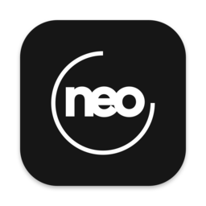

<h1 align="center">Neodesk</h1>

  Neoffice sur votre bureau, sur Mac et Windows. 
  <a href="https://github.com/bvisible/neoffice-desktop-releases/releases/latest"><strong>Télécharger la dernière version</strong></a>

<picture>
  <source media="(prefers-color-scheme: dark)" srcset="images/neodesk-hero-dark.webp">
  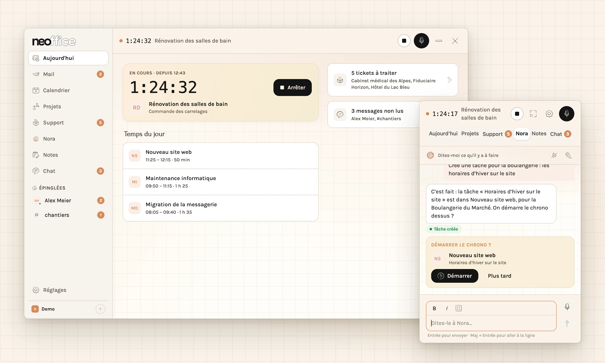
</picture>

Neodesk vit dans la barre des menus du Mac et dans la zone de notification de Windows. Un clic démarre le chrono sur une tâche, Neodesk reconnaît sur quoi vous travaillez, et chaque heure arrive dans Neoffice, sur le bon projet. En fenêtre, il ouvre aussi votre courrier et votre agenda, à côté du support, de Nora, des notes, du chat de l'équipe, de vos documents et des notifications de Neoffice.

**Neotime s'appelle maintenant Neodesk.** Une Neotime installée se met à jour toute seule en Neodesk, sans rien perdre : vos instances, vos réglages, votre chrono et vos séances pas encore envoyées restent. Sur Mac, elle devient Neodesk jusque dans le dossier Applications.

## Télécharger

Version actuelle : **0.5.9** — [toutes les versions](https://github.com/bvisible/neoffice-desktop-releases/releases)

| Ordinateur | Fichier |
| --- | --- |
| Mac avec puce Apple (M1 et suivants) | [neoffice-desktop-0.5.9-arm64.dmg](https://github.com/bvisible/neoffice-desktop-releases/releases/download/v0.5.9/neoffice-desktop-0.5.9-arm64.dmg) |
| Mac avec processeur Intel | [neoffice-desktop-0.5.9-x64.dmg](https://github.com/bvisible/neoffice-desktop-releases/releases/download/v0.5.9/neoffice-desktop-0.5.9-x64.dmg) |
| Windows 10 et 11 | [neoffice-desktop-0.5.9-setup.exe](https://github.com/bvisible/neoffice-desktop-releases/releases/download/v0.5.9/neoffice-desktop-0.5.9-setup.exe) |

Sur Mac, macOS 12 ou plus récent. Pour savoir quel Mac vous avez : menu Pomme, « À propos de ce Mac », ligne « Puce » ou « Processeur ».

## Installer

**Mac** : ouvrez le fichier `.dmg` et glissez Neodesk dans Applications. Neodesk est signé, mais pas encore notarisé : à la première ouverture, macOS peut le bloquer. Ouvrez alors Réglages Système, Confidentialité et sécurité, et cliquez sur « Ouvrir quand même ». Une seule fois.

**Windows** : lancez `neoffice-desktop-<version>-setup.exe`. Si Windows affiche « Windows a protégé votre ordinateur », choisissez « Informations complémentaires », puis « Exécuter quand même ». Neodesk s'ouvre à la fin de l'installation ; son icône rejoint la zone de notification, et Neodesk propose de l'afficher dans la barre des tâches.

Neotime est déjà installée ? Rien à télécharger : elle devient Neodesk à sa prochaine mise à jour.

## Premier lancement

1. Saisissez l'adresse de votre Neoffice, par exemple `moninstance.neoffice.me`.
2. Connectez-vous avec votre compte Neoffice.

Si Neodesk indique que l'instance n'est pas prête : un administrateur ouvre Neoffice dans le navigateur, clique sur le menu en haut à gauche, puis sur « Applications mobiles » et « Configurer le client OAuth ». C'est le même réglage que pour l'application mobile, à faire une fois.

Pour compter vos heures, il faut une fiche employé dans Neoffice ; si elle manque, Neodesk propose de la créer quand vos droits le permettent. Les agents du helpdesk ont l'onglet Support, même sans fiche employé.

## Ce que fait Neodesk

### Le chrono, sous l'icône

Un clic sur l'icône ouvre Neodesk. Choisissez un projet et sa tâche : le chrono démarre, et le temps s'affiche à côté de l'icône. À l'arrêt, la tranche rejoint votre feuille de temps du jour dans Neoffice, même si le réseau a manqué entre-temps.

<picture>
  <source media="(prefers-color-scheme: dark)" srcset="images/neodesk-popover-today-dark.webp">
  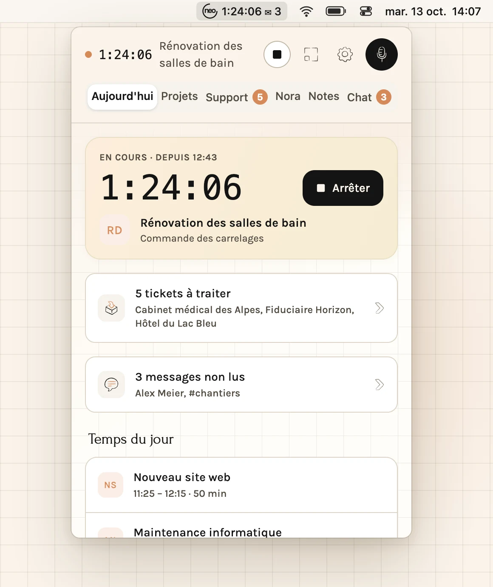
</picture>

### La fenêtre, quand il faut de la place

Le bouton à côté des réglages détache Neodesk en fenêtre : les onglets passent dans une barre latérale, la journée s'étale sur deux colonnes, et le courrier et le calendrier s'ajoutent. Sous les onglets, les conversations que vous avez épinglées. La croix la ferme et la remet sous son icône ; « — » la réduit dans le Dock, ou dans Stage Manager s'il est actif. En haut de la barre latérale, le logo Neoffice ; tout en bas, l'instance ouverte. Par défaut, Neodesk s'ouvre toujours sous l'icône.

<picture>
  <source media="(prefers-color-scheme: dark)" srcset="images/neodesk-window-today-dark.webp">
  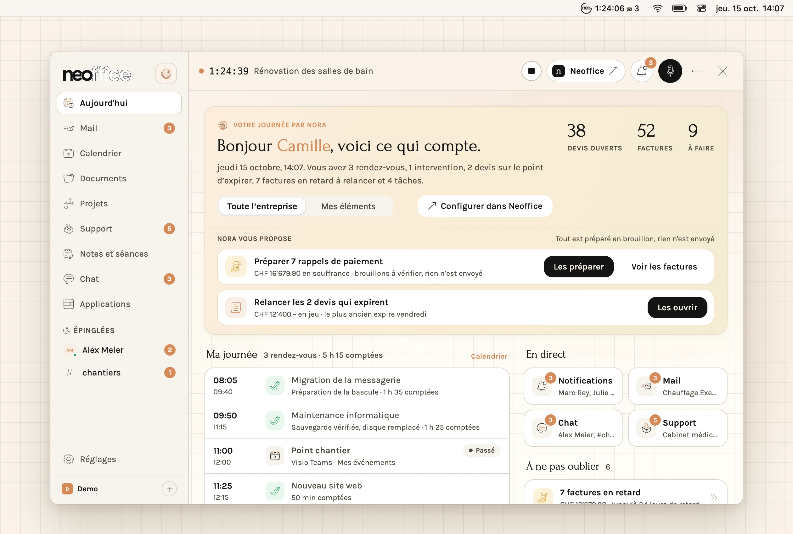
</picture>

### Le courrier

Les boîtes mail que Neoffice vous ouvre, la vôtre et celles que l'on partage avec vous, chacune avec ses non-lus ; « Toutes les boîtes » réunit leurs réceptions dans une seule liste, chaque message avec l'étiquette de sa boîte. Un clic sur « Mail » déploie leurs dossiers dans la barre latérale ; le message se lit à côté de la liste, avec la fiche de l'expéditeur quand Neoffice le connaît : un client, un fournisseur et ses factures de l'année. Un clic droit sur une pièce jointe l'enregistre dans le Drive, en fait un document scanné ou la joint à un document de Neoffice : le serveur s'en charge, rien ne passe par votre ordinateur. Les images venues d'Internet attendent votre accord.

<picture>
  <source media="(prefers-color-scheme: dark)" srcset="images/neodesk-window-mail-dark.webp">
  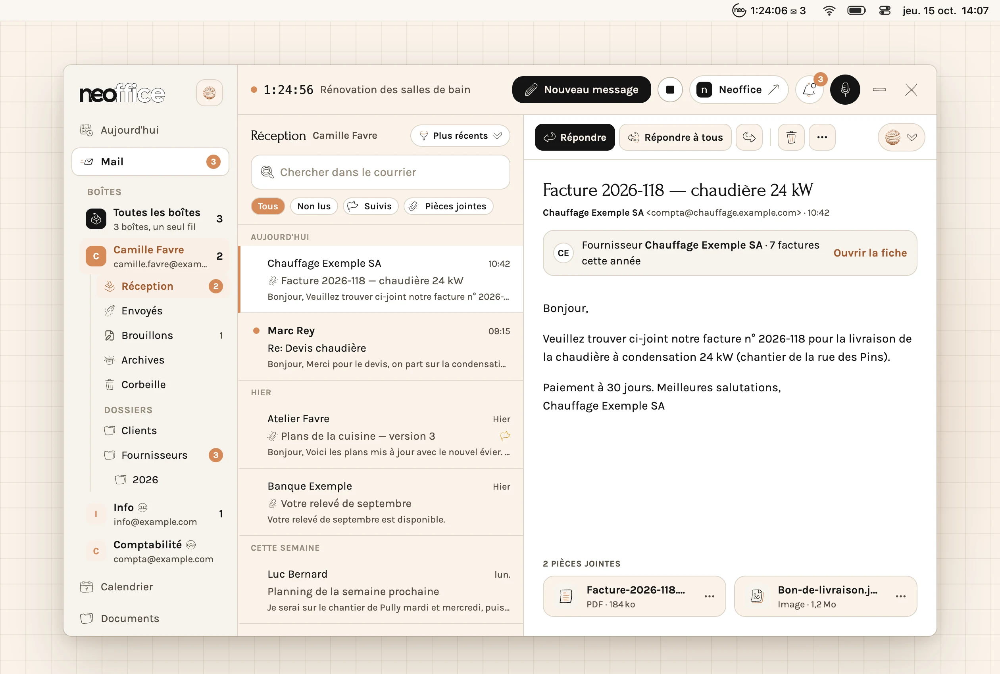
</picture>

Répondre, Répondre à tous et Transférer sont au-dessus du message ; la sphère de Nora, à côté, propose une réponse dans votre style (à l'expéditeur ou à tous) ou traduit le message, et « Corriger », « Améliorer » et « Traduire » reprennent la réponse avant l'envoi. En lisant, « 2 messages plus anciens dans cette conversation » déplie le reste du fil, vos réponses envoyées comprises. La liste se range par jour, se trie des plus récents aux plus anciens ou l'inverse, et « Non lus » ou « Suivis » trouvent tous ces messages. Écrivez un nouveau message avec sa copie cachée, joignez un document de Neoffice en PDF (les factures, devis, commandes et bons de livraison des destinataires d'abord, dans le modèle et la langue de votre choix), des fichiers du Drive ou une image collée dans le texte ; transférez avec les pièces jointes que vous gardez, cherchez, suivez, déplacez, archivez : c'est le courrier de votre Neoffice, celui du navigateur. Un message s'enregistre tout seul dans les brouillons pendant que vous écrivez, en une seule copie, et un brouillon repris se rouvre dans l'éditeur.

<picture>
  <source media="(prefers-color-scheme: dark)" srcset="images/neodesk-window-mail-nora-dark.webp">
  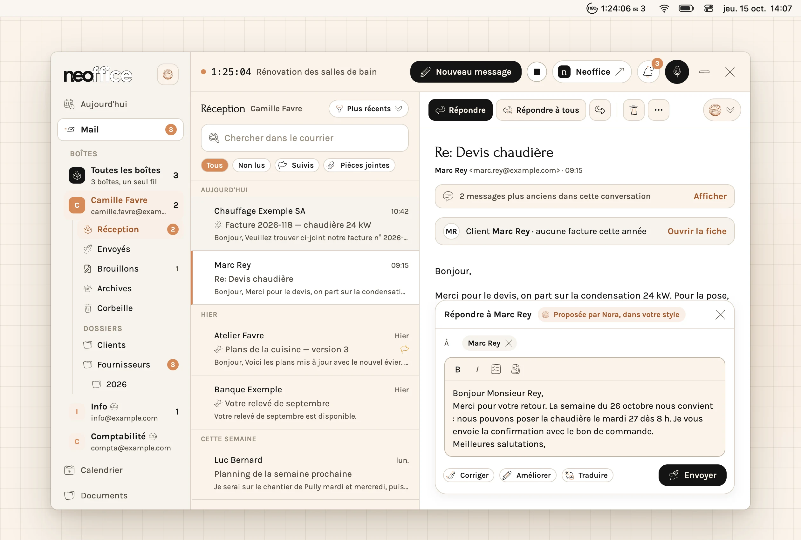
</picture>

### Vos documents

La partie **Documents** est le Drive de Neoffice dans Neodesk : on parcourt ses dossiers, on ouvre un fichier dans NeoWrite, NeoSheet, NeoSlides ou NeoPDF, on en crée, on importe, on renomme, on déplace, on duplique, on partage ; les favoris et la corbeille y sont aussi. Un fichier glissé n'importe où dans Neodesk demande où il va : « Drive » ou « Scan ». Les Scans fonctionnent comme sur le téléphone : on dépose, on valide l'envoi.

### Ouvrir un document de votre ordinateur (Mac)

Fichier › Ouvrir, ou un clic droit sur l'icône, ouvre un document Word, Excel, PowerPoint, PDF ou texte de votre ordinateur dans une fenêtre de Neodesk, et l'enregistre à sa place ; Fichier › Nouveau en crée un. L'éditeur d'un type de document se télécharge à sa première ouverture. Neodesk est proposé dans « Ouvrir avec » du Finder, sans prendre la place de vos applications habituelles.

### Les applications

La page **Applications** montre les éditeurs de documents de Neodesk (NeoWrite, NeoSheet, NeoSlides et NeoPDF) : on les installe, on les met à jour, et on ouvre un document avec eux. Un clic fait de Neodesk le programme qui ouvre un type de document ; l'ancien programme est gardé, et se remet en un clic.

### Les notifications de Neoffice

Une cloche avec son chiffre, les dernières notifications de Neoffice et des bannières quand une nouvelle arrive ; un clic ouvre la page concernée dans Neoffice. Le chiffre se retrouve dans la barre des menus, le Dock et la barre latérale.

### Imprimer depuis Neoffice

« Imprimer sur… » envoie un document de Neoffice aux imprimantes du bureau, par Neodesk, sans fenêtre ni boîte de dialogue.

### Le calendrier

L'agenda de Neoffice : vos événements, ceux de l'équipe, et les dates que Neoffice connaît déjà, comme les interventions, les congés, les tâches, les séances, les livraisons, les factures à encaisser ou à payer et les anniversaires. Un clic sur « Calendrier » déploie ces calendriers dans la barre latérale, à cocher. La semaine avec la ligne de l'heure, le jour ou le mois ; une date de Neoffice ouvre son document. « Événement » en crée un, et un clic sur l'un des vôtres le modifie ou le supprime.

<picture>
  <source media="(prefers-color-scheme: dark)" srcset="images/neodesk-window-calendar-dark.webp">
  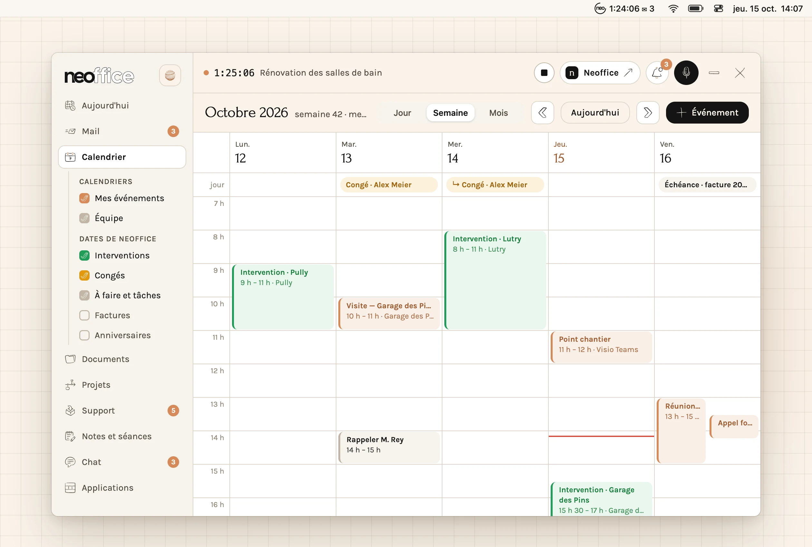
</picture>

### Les projets et la détection

Les projets où vous comptez vos heures, chacun avec « Démarrer ». Une règle peut relier une application ou un site à un projet : un plan ouvert dans AutoCAD, une maquette dans Figma, le site d'un client. Neodesk propose alors de démarrer, ou démarre tout seul. La détection est éteinte tant que vous ne l'activez pas, et ce qu'elle lit reste sur votre ordinateur.

<picture>
  <source media="(prefers-color-scheme: dark)" srcset="images/neodesk-window-projects-dark.webp">
  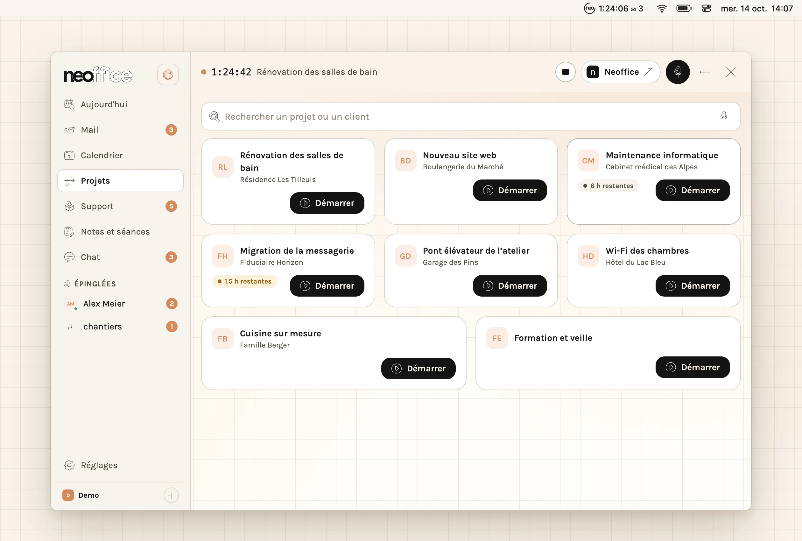
</picture>

### Le support

Les tickets du helpdesk qui vous attendent, la conversation avec le client et vos notes internes. « Prendre et commencer » démarre le chrono sur la tâche du ticket, et les heures se décomptent du forfait du client. Répondez au client, ajoutez une note, résolvez : sans ouvrir le helpdesk.

<picture>
  <source media="(prefers-color-scheme: dark)" srcset="images/neodesk-window-support-dark.webp">
  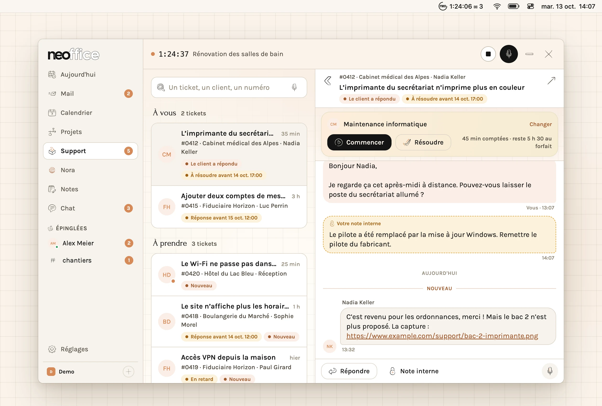
</picture>

### Nora

Parlez ou écrivez : « Crée une tâche pour la boulangerie ». Nora trouve le projet, crée la tâche et propose de démarrer le chrono. « C'est terminé » l'arrête et clôt la tâche.

<picture>
  <source media="(prefers-color-scheme: dark)" srcset="images/neodesk-popover-nora-dark.webp">
  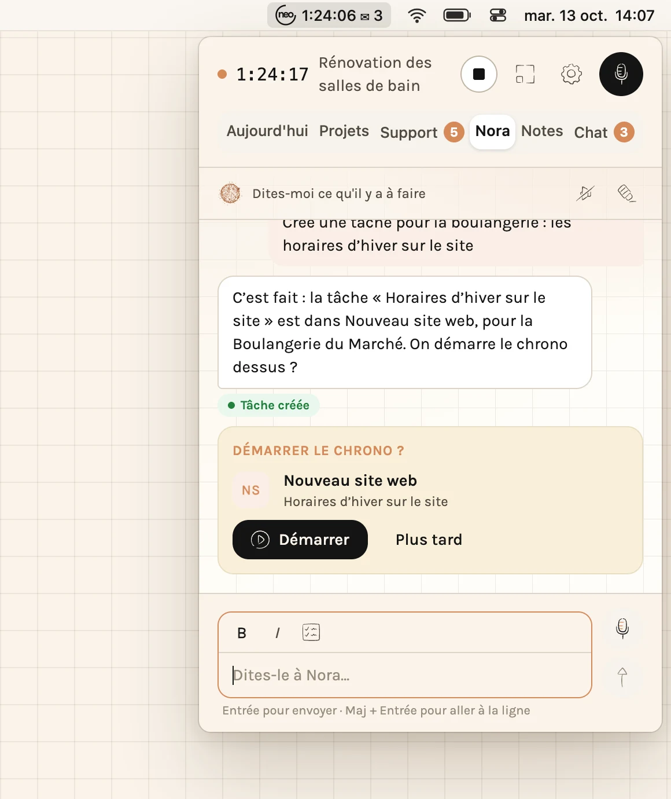
</picture>

### Les notes

Écrivez ou dictez une note, avec sa mise en forme. « Enregistrer » la garde telle quelle ; « Organiser avec Nora » lui donne un titre, un résumé et les tâches à cocher, que vous rattachez au projet.

<picture>
  <source media="(prefers-color-scheme: dark)" srcset="images/neodesk-window-notes-dark.webp">
  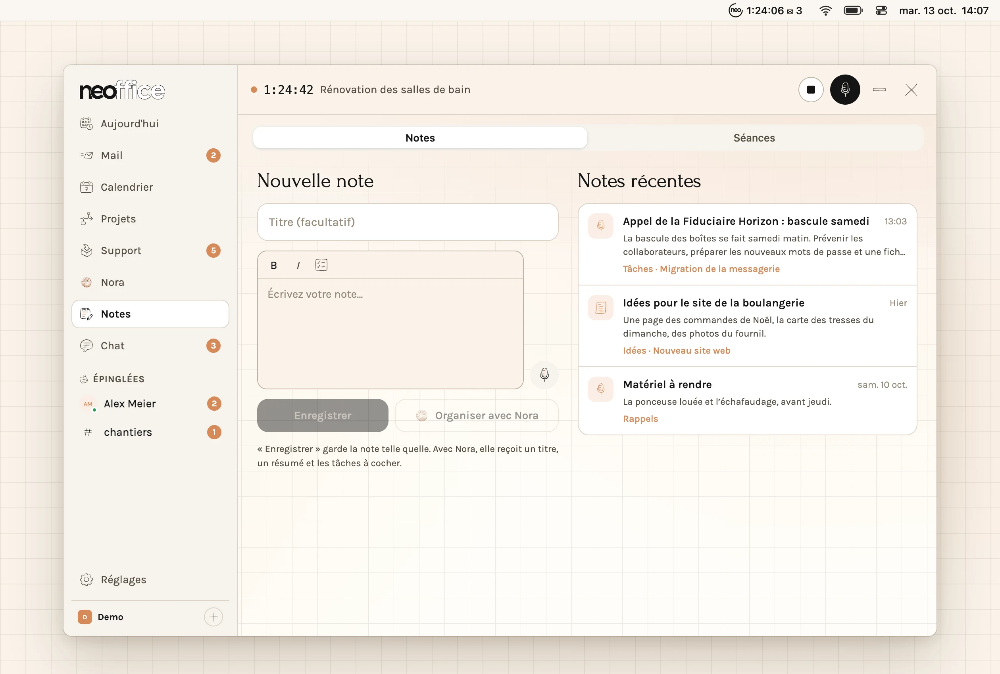
</picture>

### Les séances

Une visio, une visite, une réunion : Neodesk l'enregistre avec l'accord des participants — votre micro et, pour une visio, le son de l'ordinateur sur une seconde piste — et Neoffice en tire le procès-verbal. On relit ensuite la séance : le résumé, le procès-verbal, les actions, les voix à nommer et la transcription qui suit la voix. Les séances sont dans l'onglet Notes, quand votre Neoffice les propose.

<picture>
  <source media="(prefers-color-scheme: dark)" srcset="images/neodesk-window-meeting-dark.webp">
  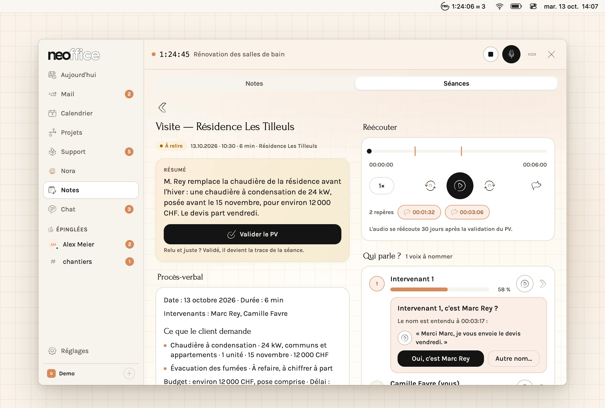
</picture>

### Le chat

Les canaux et les messages directs de Neoffice, avec la mise en page, les fichiers et les notifications. Sur Mac, on répond depuis la notification. En fenêtre, l'épingle de l'en-tête d'une conversation la met dans la barre latérale, à un clic : ce sont les mêmes épinglées que dans la messagerie de Neoffice. Un double-clic sur un message y met un 👍, comme sur le téléphone ; au survol, quatre autres réactions. Sur vos propres messages, le crayon les modifie (« modifié » s'affiche ensuite) et la corbeille les supprime, après confirmation. Un message qui arrive s'affiche tout de suite dans la conversation ouverte, même si la connexion a été coupée un moment.

<picture>
  <source media="(prefers-color-scheme: dark)" srcset="images/neodesk-window-chat-dark.webp">
  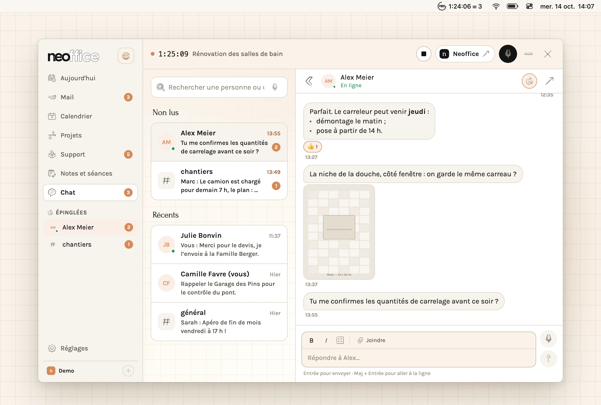
</picture>

### Sur Windows

Le même Neodesk, dans la zone de notification, juste au-dessus de la barre des tâches.

<picture>
  <source media="(prefers-color-scheme: dark)" srcset="images/neodesk-windows-dark.webp">
  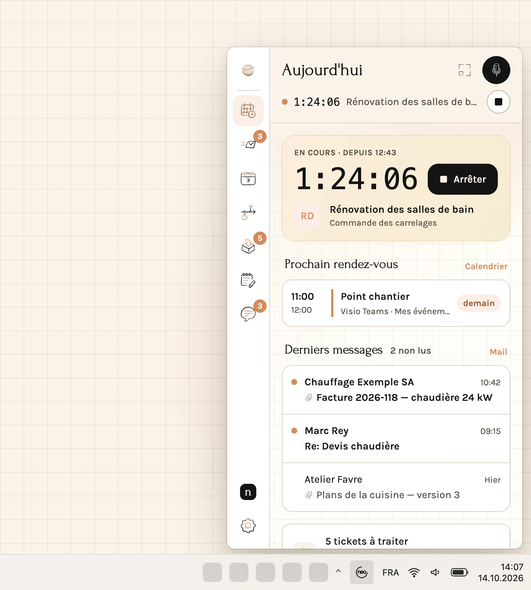
</picture>

## Mises à jour

Neodesk cherche une nouvelle version au démarrage, puis toutes les 6 heures, et la télécharge tout seul. Les Réglages disent où il en est : recherche, téléchargement, prête, à jour. Une version téléchargée s'installe à la fermeture de Neodesk, ou tout de suite avec « Redémarrer et installer ».

<picture>
  <source media="(prefers-color-scheme: dark)" srcset="images/neodesk-popover-settings-dark.webp">
  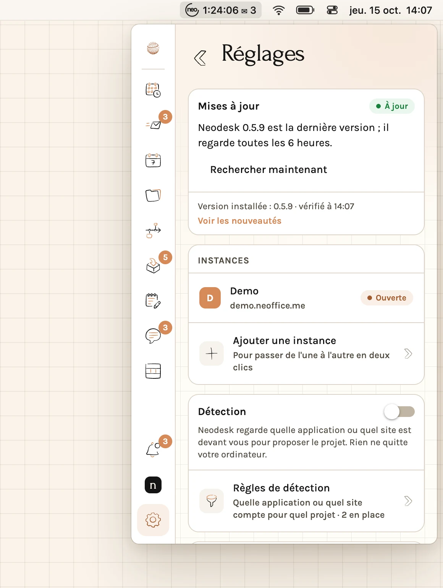
</picture>

## Questions fréquentes

**Neodesk fonctionne-t-il sans connexion ?** Le chrono, oui : les tranches de temps attendent le réseau et partent toutes seules dès qu'il revient.

**Que lit la détection ?** L'application au premier plan et le titre de sa fenêtre, et sur Mac l'adresse de la page ouverte dans le navigateur, pour les comparer à vos règles. Rien de ce qu'elle lit ne quitte votre ordinateur.

**Plusieurs Neoffice ?** Ajoutez-les dans les Réglages et passez de l'une à l'autre. Un seul chrono tourne, toutes instances confondues.

**Pourquoi le courrier ou le calendrier n'apparaît-il pas ?** Ils s'ouvrent en fenêtre. Le courrier demande une boîte mail ouverte pour vous dans Neoffice ; le calendrier, l'agenda de Neoffice. Votre administrateur les active.

**Comment désinstaller ?** Mac : quittez Neodesk (Réglages, « Quitter Neodesk ») et glissez-le à la corbeille. Windows : Paramètres, Applications, Neodesk, Désinstaller.

---

Ce dépôt ne contient que les installeurs et les fichiers que Neodesk lit pour se mettre à jour ; le code source est privé. Les images montrent des données fictives.
